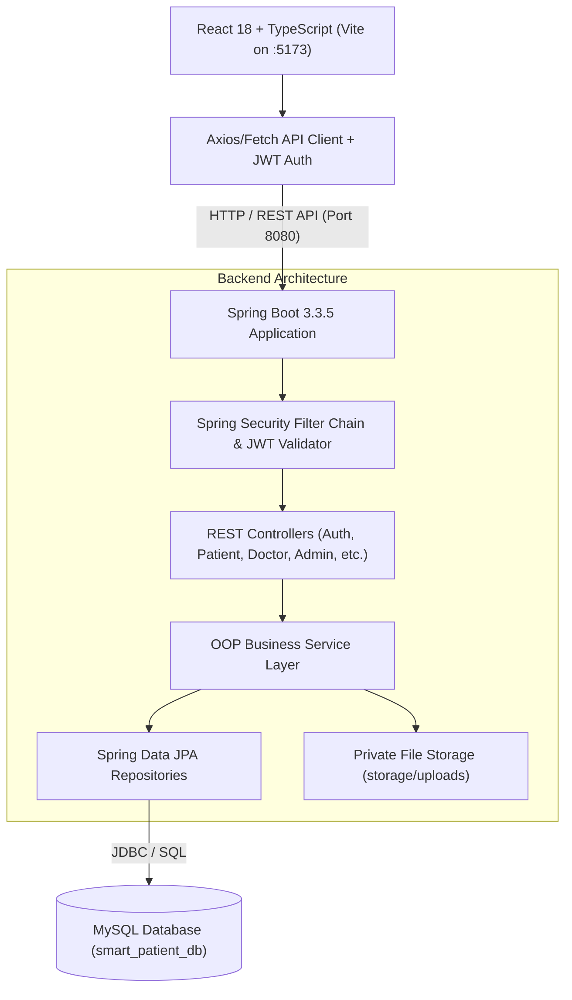
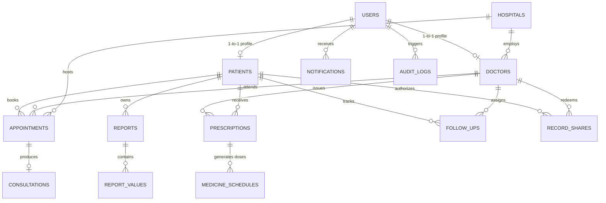

# SMART PATIENT — Smart Patient Health & Hospital Management System

> **Academic Course Project**: PBLCST304 — Object Oriented Programming  
> **Institution**: Providence College of Engineering, Department of Computer Science & Engineering  
> **Semester**: 3 | **Academic Year**: 2026  
> **Project Guide**: Chitra Mohan  
> **Team Members**:  
> - Deepak Biju  
> - Avanthika Aneesh  
> - Henin Alosius  
> - Aman M  
> - Aron George Daniel  

---

## 1. Project Introduction
**Smart Patient** is a patient-centred digital healthcare and hospital management platform designed to place patients in direct, sovereign control of their personal medical records. Unlike conventional internal hospital ERP systems that treat patient records as proprietary departmental data, Smart Patient assigns every individual a universal, unique **Patient ID** (e.g., `PT-2026-0001`).

Patients can schedule appointments with verified doctors across partner hospitals, securely upload medical reports and scans, track daily medicine doses with reminders, compare compatible laboratory report values across dates to track disease markers, and share specific medical records with doctors using time-limited, revocable sharing codes.

---

## 2. Problem Statement
Traditional hospital management systems suffer from data fragmentation:
- **Siloed Records**: Diagnostic reports and prescriptions are scattered across multiple clinics and paper files, hindering emergency response and longitudinal care.
- **Lack of Patient Control**: Patients cannot easily grant or revoke doctor access to specific historical documents.
- **Inability to Track Clinical Trends**: Laboratory reports (such as lipid panels or glycemic indicators) are read as static sheets, making it difficult for patients to visualize progress over time.
- **Treatment Non-Adherence**: Patients frequently miss medication doses or post-consultation follow-up appointments due to the absence of scheduled daily dose management.

---

## 3. Project Objectives
1. Provide a centralised, patient-owned health repository linked to a verified Patient ID.
2. Implement patient-controlled record sharing with cryptographically generated, time-limited, and revocable sharing codes (`SH-XXXXXX`).
3. Build a structured laboratory report comparison engine that computes percentage changes and trend directions without generating unauthorized medical diagnoses.
4. Manage structured medication schedules with daily dose adherence tracking (Taken, Missed, Pending).
5. Demonstrate core **Object-Oriented Programming (OOP)** principles in real enterprise Java backend design.
6. Provide role-based access control isolating **Patient**, **Doctor**, and **Administrator** privileges according to healthcare security principles.

---

## 4. Key Features

### For Patients
- **Centralised Digital ID**: Unique readable Patient ID (`PT-2026-0001`) with personal demographics, blood group, allergies, and emergency contacts.
- **Personal Health Dashboard**: Real-time summary cards for Upcoming Appointments, Latest Medical Report, Today's Medicine Progress, and Next Follow-up, backed by a chronological activity timeline.
- **Find Care**: Search hospitals and doctors by name, specialty, and location.
- **Appointment Booking**: Prevent double-booking with 30-minute availability slots, unique appointment references, and queue token numbers.
- **Document Management**: Upload, preview, and download laboratory reports and scans (PDF/PNG/JPEG) stored in private storage.
- **Laboratory Report Comparison**: Select two compatible lab reports (e.g., Lipid Profiles or Blood Sugar tests) to calculate absolute differences, percentage changes, and trend arrows with clinical disclaimers.
- **Medicine Tracker**: View daily schedules (Morning, Afternoon, Evening, Bedtime) with food instructions and mark doses as TAKEN or MISSED.
- **Follow-up Management**: View doctor-recommended follow-up dates and schedule review appointments.
- **Patient-Controlled Sharing**: Generate secure, single-use sharing codes with expiration times and instant revocation.

### For Doctors
- **Doctor Consultation Workspace**: View scheduled appointments, review patient summaries, and access shared patient records.
- **Redeem Sharing Code**: Gain temporary, audited clinical access to records explicitly authorized by the patient.
- **Clinical Consultations**: Record consultation notes, prescribe medicines with food instructions, set follow-up dates, and upload lab/imaging reports.

### For Administrators
- **System Governance**: Monitor system metrics (total patients, doctors, hospitals, pending accounts).
- **Doctor Verification**: Review medical license credentials and approve or reject doctor registrations with audited rationale.
- **Hospital Directory Management**: Add and maintain healthcare partner facilities and services.
- **User Account Governance**: Suspend or reactivate user accounts.
- **Security Audit Trails**: Review immutable system audit logs tracking logins, record shares, and admin actions.
- *Strict Least Privilege*: Administrators **cannot** view or download private patient medical files.

---

## 5. Technology Stack

### Frontend
- **Framework**: React 18 with TypeScript
- **Build Tool**: Vite
- **Styling**: Tailwind CSS with custom healthcare palette (`#102B4E` Primary Navy, `#119E91` Primary Teal, `#F3F8FC` Pale Blue)
- **Icons**: Lucide React
- **Routing**: React Router DOM (v6) with Role Guards
- **Data Fetching & State**: TanStack React Query (v5)

### Backend
- **Language**: Java 17+ (Compiled and tested on Java 26 target 17)
- **Framework**: Spring Boot 3.3.5
- **Security**: Spring Security 6 with stateless JWT Bearer Token Authentication (BCrypt password hashing)
- **Persistence**: Spring Data JPA / Hibernate 6
- **Database**: MySQL 8.x / MariaDB 10.4
- **Build Tool**: Apache Maven 3.9+
- **Monitoring**: Spring Boot Actuator (`/actuator/health`)

---

## 6. Architecture Overview



---

## 7. Database Schema & Entity Relationships



The relational database `smart_patient_db` comprises **16 normalized tables**:
1. `users`: Credentials, roles (`PATIENT`, `DOCTOR`, `ADMIN`), and account statuses (`ACTIVE`, `PENDING_VERIFICATION`, `SUSPENDED`).
2. `patients`: Human-readable `patient_code` (`PT-2026-0001`), demographics, blood group, allergies, and emergency contact details.
3. `doctors`: Medical qualifications, specialty, license reference, hospital affiliation, and `verification_status`.
4. `hospitals`: Name, city, address, phone, and flags for digital report and online booking support.
5. `appointments`: Unique booking references, slot timestamps, token numbers, status (`BOOKED`, `CONFIRMED`, `COMPLETED`, `CANCELLED`).
6. `reports`: Medical document metadata (PDF, PNG, JPEG), storage key, file size, mime-type, upload source.
7. `report_values`: Structured laboratory analytes (Test Name, normalized key, numeric value, units, reference range min/max).
8. `consultations`: Clinical encounter observations and doctor recommendations.
9. `prescriptions`: Prescribed drug, dosage, route, frequency, date intervals, and food instructions.
10. `medicine_schedules`: Granular dose slots (`MORNING`, `AFTERNOON`, `EVENING`, `BEDTIME`) with `TAKEN`, `MISSED`, or `PENDING` statuses.
11. `follow_ups`: Scheduled clinical review dates, reason, and status.
12. `record_shares`: Revocable authorization grants with cryptographic hash of sharing codes (`SH-XXXXXX`).
13. `record_share_items`: Scoped access categories (`LAB_REPORTS`, `SCANS`, `PRESCRIPTIONS`).
14. `notifications`: In-app alerts for appointments, dose reminders, and clinical updates.
15. `audit_logs`: Immutable tracking of security actions with actors, outcomes, and timestamps.
16. `doctor_hospitals`: Multi-facility affiliation junction table.

---

## 8. Object-Oriented Programming (OOP) Concepts Demonstrated

As a core requirement for **PBLCST304 — Object Oriented Programming**, the backend demonstrates OOP principles directly in Java code:

1. **Encapsulation**:
   - Entities (`Patient`, `MedicineSchedule`, `Prescription`, etc.) maintain private internal fields with controlled mutator methods (`markTaken()`, `markMissed()`, `resetPending()`, `revoke()`). Direct unchecked entity mutation is prohibited.
   - Domain logic and business rules are encapsulated in services (`MedicineService`, `ReportService`, `AppointmentService`).

2. **Inheritance & Hierarchy**:
   - Abstract models and base classes share common lifecycle properties (`createdAt`, `updatedAt`).
   - Standard response structures (`ApiResponse<T>`) encapsulate API responses uniformly across all controllers.

3. **Polymorphism**:
   - Dynamic dispatch in report comparison engines comparing numerical measurements across compatible medical units.
   - Spring Security's `UserDetailsService` and `AuthenticationProvider` implementations resolving polymorphic user principals (`UserPrincipal`).

4. **Abstraction**:
   - Decoupled interfaces (`PatientRepository`, `DoctorRepository`, `AuditService`) abstracting relational persistence and query optimization away from web controllers.
   - Storage service abstraction separating the local file system implementation from the document management service.

---

## 9. Security & Access Control Model

| Endpoint Category | Patient Role | Doctor Role | Admin Role |
| :--- | :---: | :---: | :---: |
| Authentication (`/api/auth/*`) | Accessible | Accessible | Accessible |
| Patient Dashboard & Timeline (`/api/patients/me/*`) | Own Data Only | Denied | Denied |
| Book Appointment (`POST /api/appointments`) | Self Only | Denied | Denied |
| Doctor Appointments (`/api/doctors/me/*`) | Denied | Assigned Only | Denied |
| View / Upload Medical Report (`/api/reports/*`) | Own Records | Granted via Share | Denied (No file access) |
| Compare Lab Reports (`POST /api/reports/compare`) | Own Records | Denied | Denied |
| Track Medicine Dose (`/api/medicine-schedules/*`) | Own Records | Denied | Denied |
| Generate Sharing Code (`POST /api/shares`) | Permitted | Denied | Denied |
| Redeem Sharing Code (`POST /api/shares/redeem`) | Denied | Permitted | Denied |
| Revoke Sharing Access (`POST /api/shares/{id}/revoke`) | Permitted | Denied | Denied |
| Doctor Approvals (`/api/admin/doctors/*`) | Denied | Denied | Permitted |
| User Status Toggle (`/api/admin/users/*`) | Denied | Denied | Permitted |
| Security Audit Logs (`/api/admin/audit-logs`) | Denied | Denied | Permitted |

---

## 10. Demonstration Accounts

For local demonstration and academic evaluation, the system pre-seeds the following verified accounts:

| Role | Username | Password | Full Name / Description |
| :--- | :--- | :--- | :--- |
| **Patient** | `patient1` | `Patient@123` | Deepak Biju (Patient ID: `PT-2026-0001`, A+ Blood) |
| **Doctor (Verified)** | `dr.sharma` | `Doctor@123` | Dr. Rajesh Sharma (Cardiology, Apollo Hospital) |
| **Doctor (Verified)** | `dr.priya` | `Doctor@123` | Dr. Priya Menon (General Medicine, City Care) |
| **Doctor (Pending)** | `dr.anita` | `Doctor@123` | Dr. Anita Nair (Neurology - Awaiting Admin Approval) |
| **Administrator** | `admin` | `Admin@123` | System Administrator (Full governance access) |

> *Quick-Fill feature: The web login page includes one-click buttons to automatically fill credentials for any demo role.*

---

## 11. Prerequisites & Installation

### Software Requirements
- **Operating System**: Windows 10/11, macOS, or Linux
- **Java Development Kit (JDK)**: Java 17 or higher
- **Node.js**: v18 or newer (tested on v24.20 LTS)
- **MySQL / MariaDB Server**: MySQL 8.0+ or XAMPP MariaDB (port 3306)
- **Maven**: 3.8+ (A pre-configured `mvnw.cmd` wrapper is included in the `backend/` folder)

---

## 12. Step-by-Step Setup & Execution

### Step 1: Start MySQL Database
Ensure MySQL is running on port `3306`. Create the database if it doesn't already exist:
```sql
CREATE DATABASE IF NOT EXISTS smart_patient_db CHARACTER SET utf8mb4 COLLATE utf8mb4_unicode_ci;
```

### Step 2: Run the Java Spring Boot Backend
Open a terminal in `backend/`:
```powershell
# Windows PowerShell:
cd backend
.\mvnw.cmd spring-boot:run

# macOS / Linux:
cd backend
./mvnw spring-boot:run
```
*The backend will automatically create all 16 relational database tables and seed initial demonstration accounts, hospitals, lab reports, and medication schedules. The API will listen on `http://localhost:8080`.*

Verify backend health by visiting: `http://localhost:8080/actuator/health` (returns `{"status":"UP"}`).

### Step 3: Run the React Frontend
Open a second terminal in `frontend/`:
```powershell
# Windows PowerShell:
cd frontend
.\npmw.cmd run dev

# macOS / Linux (using regular npm):
cd frontend
npm run dev
```
*The Vite development server will start at `http://localhost:5173`.*

---

## 13. Running Automated Tests
The project includes automated integration and workflow tests:

```powershell
# Execute backend unit & comparison logic tests:
cd backend
.\mvnw.cmd test

# Execute live end-to-end API verification test script:
powershell -ExecutionPolicy Bypass -File .\backend\test-workflows.ps1

# Execute patient sharing and redemption verification:
powershell -ExecutionPolicy Bypass -File .\backend\test-sharing.ps1
```

---

## 14. REST API Endpoint Reference

### Authentication
- `POST /api/auth/register` — Register a new patient account and generate unique Patient ID.
- `POST /api/auth/login` — Authenticate credentials and return JWT bearer token.
- `GET /api/auth/me` — Retrieve current authenticated user profile summary.
- `POST /api/auth/logout` — Invalidate user session.

### Patients & Care
- `GET /api/patients/me/dashboard` — Summary metrics for the 4 dashboard cards and activity timeline.
- `GET /api/hospitals` — List all active partner hospitals.
- `GET /api/doctors` — Search doctors by specialty, name, or hospital.
- `GET /api/appointments/slots` — Fetch real-time available 30-minute booking slots.
- `POST /api/appointments` — Book an appointment with concurrency conflict protection.
- `POST /api/appointments/{id}/cancel` — Cancel an appointment.

### Reports & Laboratory Comparisons
- `GET /api/reports` — List patient's medical reports (filtered by type: LAB or SCAN).
- `POST /api/reports/upload` — Upload medical document (PDF/PNG/JPEG) with optional structured test values.
- `GET /api/reports/{id}/download` — Securely stream file with ownership verification.
- `POST /api/reports/compare` — Compare two compatible lab reports with delta & trend analysis.

### Medication Management
- `GET /api/medicine-schedules/today` — Retrieve today's medication dose slots.
- `POST /api/medicine-schedules/{id}/status` — Mark dose status as `TAKEN` or `MISSED`.
- `GET /api/medicine-schedules/summary` — Daily medication adherence rate.

### Patient-Controlled Sharing
- `POST /api/shares` — Issue time-limited sharing code (`SH-XXXXXX`).
- `POST /api/shares/redeem` — Doctor redeems code to gain scoped clinical access.
- `POST /api/shares/{id}/revoke` — Instantly revoke doctor access.

### Administration
- `GET /api/admin/stats` — High-level governance metrics.
- `GET /api/admin/doctors/pending` — List pending medical license applications.
- `POST /api/admin/doctors/{id}/approve` — Approve doctor account.
- `POST /api/admin/doctors/{id}/reject` — Reject doctor application with logged reason.
- `PATCH /api/admin/users/{id}/status` — Toggle user status (`ACTIVE` / `SUSPENDED`).
- `GET /api/admin/audit-logs` — Immutable audit trail of administrative and security events.

---

## 15. Future Scope & Enhancements
1. **ABHA / ABDM Integration**: Linking national health IDs (Ayushman Bharat Digital Mission) using official government sandbox gateways.
2. **HL7 FHIR Interoperability**: FHIR JSON resource standards (`Observation`, `DiagnosticReport`, `MedicationRequest`) for hospital record interchange.
3. **Automated OCR / NLP Extraction**: Validated parsing of scanned laboratory PDFs into structured numerical tables.
4. **Telemedicine Consultations**: Integrated WebRTC video consultation sessions between patients and doctors.
5. **Push Notifications & SMS**: Integration with Twilio / Firebase for real-time medication and appointment alerts.
